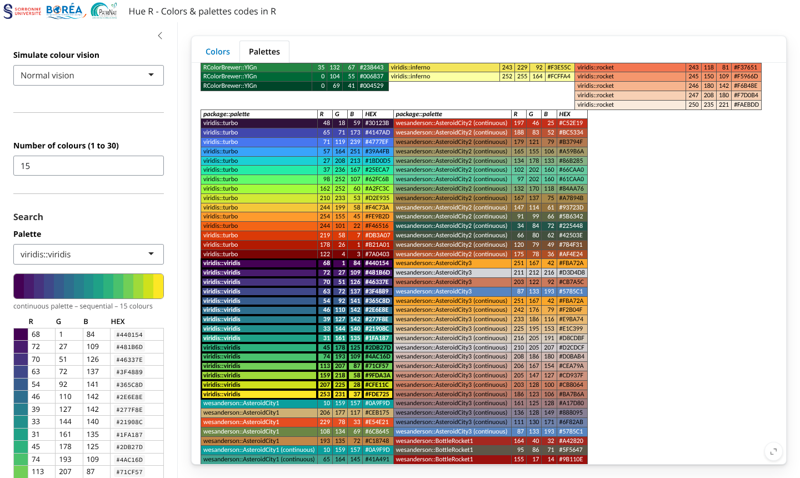
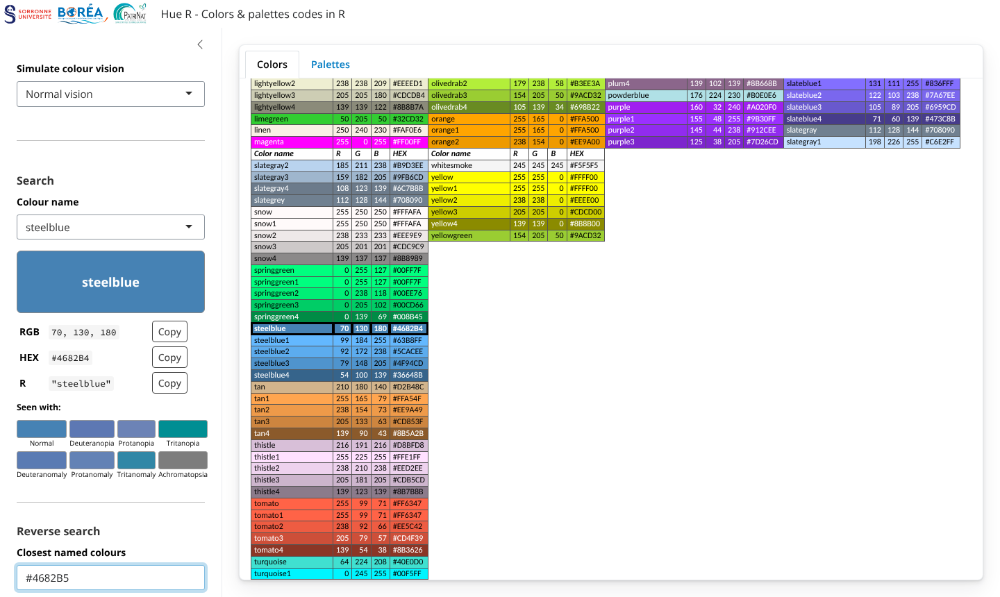
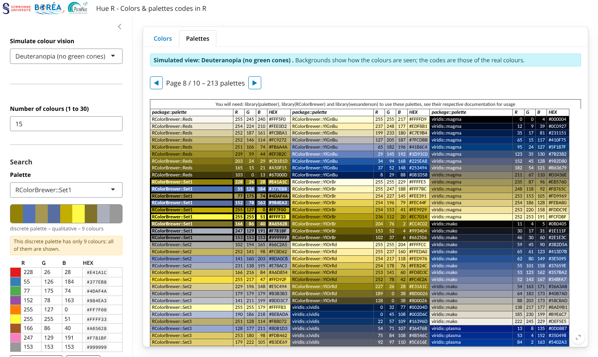
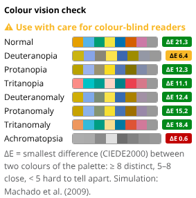

# Hue R

### *Who are you, colour?* Every named colour and palette of R, with its RGB and HEX codes and a colour-blindness check.

[](https://j-ydi.github.io/Hue_R/)
[](https://github.com/J-YDi/Hue_R/actions/workflows/deploy-shinylive.yml)


**👉 https://j-ydi.github.io/Hue_R/**

Hue R runs **entirely in your browser** with Shinylive (R compiled to WebAssembly): no R installation, no server, no account. Open the link and start picking colours.



---

## Why Hue R?

Picking colours in R usually means guessing names like `"steelblue"`, digging through package documentation to find a palette, and hoping the figure stays readable for the **1 man in 12** with a colour vision deficiency. Hue R puts it all on one page:

- 🎨 **657 named colours** and **2,918 palettes** from **82 packages**, browsable as colour sheets
- 🔢 **RGB and HEX codes** for any colour, and for any palette with **1 to 30 colours**
- 📋 **One-click copy**, including a ready-to-paste R vector `c("#…", "#…")` and the R code that generates the palette
- 👁️ **Colour vision simulation** (7 types) and a **colour-blind check** for every palette
- 🔍 **Reverse search**: paste a HEX or RGB value, get the closest named R colours

---

## What the app does

### 🎨 Colors tab: the 657 named colours of R



- **Colour sheet**: all colours returned by `colors()` (usable in base R and ggplot2), each row coloured by its own colour, with its name, R, G, B and HEX code.
- **Search by name** with autocompletion: a large swatch, the RGB code, the HEX code and the R string (`"steelblue"`), each with a **Copy** button. The colour is highlighted in the sheet.
- **Click any row** of the sheet to get its codes.
- **Reverse search**: type a HEX code (`#4682B5`, `#48b`) or an RGB triplet (`70, 130, 181`) and get the **5 closest named colours**, ranked by perceptual distance (CIE Lab).
- **"Seen with"**: the selected colour as seen with each type of colour vision.

### 🌈 Palettes tab: 2,918 palettes for any number of colours

- **Choose the number of colours first** (1 to 30): the whole sheet is regenerated for that number.
- **Strict mode** (optional): only shows the palettes that have at least the chosen number of colours.
- **Palette sheet**, paginated and filtered by **type** (continuous, discrete, dynamic) and **package** (with a *Select all / none* button).
- **Search a palette** by name (`package::palette`, with autocompletion), or click it in the sheet. You get:
  - a colour strip and the table of **R, G, B and HEX codes** of its colours,
  - **Copy HEX vector** → `c("#440154", "#3B528B", …)`, ready to paste in `scale_colour_manual(values = …)`,
  - **Copy RGB**,
  - the **R code that reproduces exactly these colours** (`paletteer::paletteer_c("viridis::viridis", n = 15)`, …),
  - a **colour vision check** (see below).
- **Discrete palettes** have a fixed number of colours (e.g. `RColorBrewer::Set1` has 9): when more colours are requested, all of their colours are shown, with a message.

**Sources of the palettes**

| Type | Palettes | Source |
|---|---|---|
| Continuous | 348 | `paletteer_c()` (base R `grDevices`, viridis, scico, ggthemes, pals…), Wes Anderson palettes interpolated with `wes_palette(type = "continuous")`, ggplot2 default hue palette |
| Discrete | 2,545 | `paletteer_d()` (RColorBrewer, ggthemes, MetBrewer, wesanderson, khroma, colorblindr…) |
| Dynamic | 25 | `paletteer_dynamic()` (cartography, ggthemes) |

### 👁️ Colour vision: simulation and colour-blind check



- **Simulate colour vision** (menu at the top of the sidebar): the whole sheet, in both tabs, is recoloured as seen with the selected type of vision. The codes shown remain those of the real colours.

| Type | What is affected | Form |
|---|---|---|
| Deuteranopia | green cones (M) missing | complete |
| Protanopia | red cones (L) missing | complete |
| Tritanopia | blue cones (S) missing | complete |
| Deuteranomaly | green cones shifted | partial, the most common |
| Protanomaly | red cones shifted | partial |
| Tritanomaly | blue cones shifted | partial |
| Achromatopsia | no colour perception (greyscale) | also a test for black-and-white printing |



- **Colour vision check** of the selected palette: one strip per type of vision, with the smallest colour difference between two of its colours (ΔE) and a verdict:
  - ✔ **Colour-blind friendly**
  - ⚠ **Use with care for colour-blind readers**
  - ✖ **Not colour-blind friendly**
- **Colour-blind friendly filter**: a slider keeps only the palettes whose colours stay distinct with deuteranopia, protanopia and tritanopia, for the chosen number of colours.

<br clear="right">

---

## Method: colour vision simulation and check

### 1. Simulation

Colour vision deficiencies are simulated with the physiologically based model of **Machado, Oliveira & Fernandes (2009)**, the reference model in data visualisation:

1. Each sRGB colour (0–255) is scaled to [0, 1] and **linearised** (inverse sRGB gamma: `c / 12.92` if `c ≤ 0.04045`, else `((c + 0.055) / 1.055)^2.4`).
2. The linear RGB vector is multiplied by the **3 × 3 matrix** of the deficiency:
   - complete forms (deuteranopia, protanopia, tritanopia): matrices for **severity 1**,
   - partial forms (deuteranomaly, protanomaly, tritanomaly): matrices for **severity 0.6** (a moderate deficiency).
3. Values are clipped to [0, 1] and converted back to sRGB (gamma), then to HEX.
4. **Achromatopsia** is simulated by the relative luminance `Y = 0.2126 R + 0.7152 G + 0.0722 B` (Rec. 709 coefficients, linear RGB), used for the three channels.

**Validation**: the simulated colours are **identical** (difference of 0 on the 0–255 scale) to those of `colorspace::deutan()`, `protan()` and `tritan()` (Zeileis et al., 2020) for the same severities.

### 2. Colour difference

The difference between two colours is measured with **CIEDE2000** (ΔE₀₀), the CIE standard for perceived colour difference:

- colours are converted from sRGB to **CIE L\*a\*b\*** (D65 white point) with `grDevices::convertColor()`,
- ΔE₀₀ is computed with the formulas of **Sharma, Wu & Dalal (2005)**. The implementation reproduces their reference test values (e.g. 2.0425 and 27.1492).

### 3. Colour-blind check of a palette

For a palette of *n* colours and for each type of vision:

1. the *n* colours are simulated,
2. ΔE₀₀ is computed for **all pairs** of colours (*n*(*n* − 1)/2 pairs),
3. the score is the **smallest ΔE₀₀**: the two colours that are the hardest to tell apart.

The verdict uses the **worst score among the three complete forms** (deuteranopia, protanopia, tritanopia):

| Smallest ΔE₀₀ | Verdict |
|---|---|
| ≥ 8 | ✔ Colour-blind friendly |
| 5 to 8 | ⚠ Use with care |
| < 5 | ✖ Not colour-blind friendly |

The thresholds were set on reference palettes. With 6 colours, `viridis` (ΔE 9.3), `khroma::bright` (8.6), `rcartocolor::Safe` (11.7) and the Okabe–Ito palette (11.5) are friendly; `RColorBrewer::Dark2` (3.4) and `RColorBrewer::Set1` (4.3) are not. With its 8 colours, Okabe–Ito drops to "use with care" (6.4), because its grey and its reddish purple look alike with deuteranopia. The scores of all palettes, for each number of colours from 2 to 30, are pre-computed so that the filter is instant.

### Limitations

- A simulation is an **approximation**: deficiencies vary from one person to another, and the partial forms are shown for one severity only (0.6).
- The check only looks at the **colours**: the size of the marks, the background, the contrast and the use of shapes or labels also matter for readability.
- In **sequential palettes** with many colours, neighbouring colours are close even for normal vision, and the check flags them. Use fewer colours, or compare with the score for normal vision, shown in the same panel.

---

## Run it locally

```r
install.packages(c("shiny", "bslib"))
shiny::runApp("app")
```

## Repository structure

| Path | Content |
|---|---|
| `app/app.R` | the Shiny app (only needs `shiny` and `bslib`) |
| `app/cvd.R` | colour vision simulation and CIEDE2000 colour difference |
| `app/data/` | pre-computed colours, palettes and colour vision checks |
| `app/www/logo.png` | logos |
| `data-raw/build_data.R` | rebuilds `app/data/` (needs `paletteer`, `wesanderson` and the palette packages used by `paletteer`); run it from the repository root, e.g. after updating `paletteer` |
| `docs/` | screenshots used in this README |
| `.github/workflows/deploy-shinylive.yml` | exports the app with Shinylive and publishes it on GitHub Pages at each push on `main` |

The static PDF and Excel versions of the colour sheets are in [colors_codes_in_R](https://github.com/J-YDi/colors_codes_in_R).

## References

- Machado G. M., Oliveira M. M. & Fernandes L. A. F. (2009). A physiologically-based model for simulation of color vision deficiency. *IEEE Transactions on Visualization and Computer Graphics*, 15(6), 1291–1298.
- Sharma G., Wu W. & Dalal E. N. (2005). The CIEDE2000 color-difference formula: implementation notes, supplementary test data, and mathematical observations. *Color Research & Application*, 30(1), 21–30.
- Zeileis A., Fisher J. C., Hornik K., Ihaka R., McWhite C. D., Murrell P., Stauffer R. & Wilke C. O. (2020). colorspace: A toolbox for manipulating and assessing colors and palettes. *Journal of Statistical Software*, 96(1), 1–49.
- Okabe M. & Ito K. (2008). *Color Universal Design (CUD): how to make figures and presentations that are friendly to colorblind people*. https://jfly.uni-koeln.de/color/
- Hvitfeldt E. *paletteer: Comprehensive Collection of Color Palettes*. R package. https://github.com/EmilHvitfeldt/paletteer

## Development

The code and documentation of this app were developed with the help of **Claude (Anthropic)**, an AI assistant; all content was reviewed and validated by the author.

---

© 2026 Jean-Yves Dias
